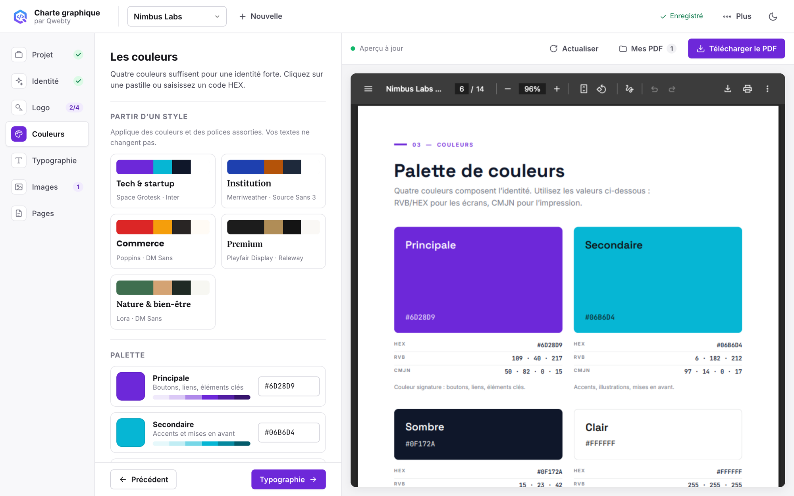
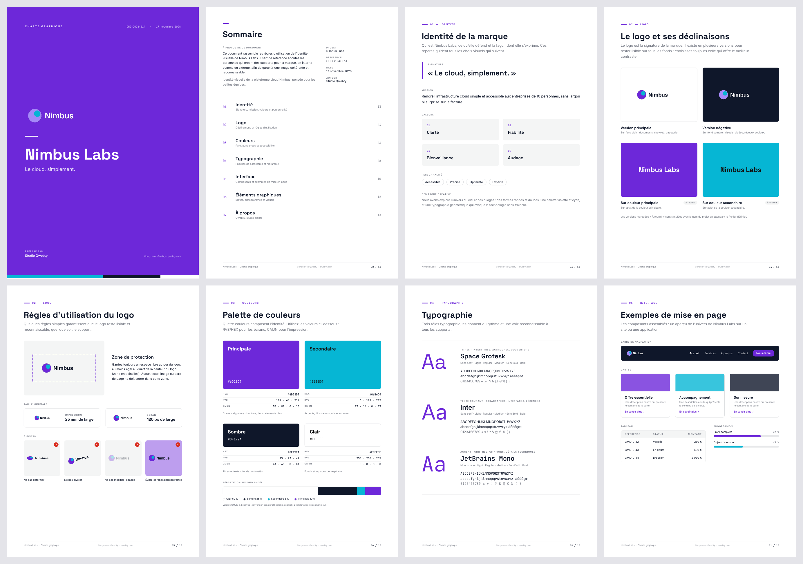

# Charte Graphique Generator

A React + Express web app that produces a professional **brand guidelines PDF** ("charte graphique"): logo, colour palette, typography, UI kit and graphic elements. A step-by-step editor sits next to a **live preview of the real PDF**, so what you see is exactly what you download.

> The UI and the generated documents are in French. PDFs carry a discreet "Conçu avec Qwebty" credit and an optional "About Qwebty" page.

## Screenshots

*Screenshots use a fictional brand ("Nimbus Labs") styled with the built-in "Tech & startup" style.*





## How it works

The editor guides you through 7 short steps. Every change is saved automatically and the preview jumps to the matching page of the PDF.

1. **Projet** — brand name, short presentation, author, date, reference.
2. **Identité** — tagline, mission, values and personality.
3. **Logo** — one version per background (light, dark, primary, secondary). PNG, JPEG, WebP or SVG.
4. **Couleurs** — four colours, ready-made styles, live readability (WCAG contrast) check.
5. **Typographie** — a font for titles, body text and accents, from 12 embedded Google Fonts or your own files.
6. **Images** — patterns, icons, illustrations shown in a gallery.
7. **Pages** — choose which chapters go into the document.

Click **Télécharger le PDF**: the file is generated, saved in `data/output/` and downloaded.

## What the PDF contains

- Coloured cover with logo, name and tagline, and a back cover
- Table of contents with document details
- Brand identity: tagline, mission, values, personality, creative approach
- Logo: variants on every background, clear space, minimum sizes, misuse examples
- Colours: HEX / RGB / CMYK values, recommended proportions, tint scales, WCAG contrast pairs
- Typography: font families per role and a full type scale
- UI kit: buttons, form fields, controls, badges, alerts, navigation bar, cards, table, progress
- Graphic elements gallery (several pages if needed)
- About Qwebty page (optional)

Fonts are embedded, French typography rules are applied (non-breaking spaces, curly apostrophes), text colours are picked automatically for contrast, and the PDF includes bookmarks and metadata.

## Features

- Live PDF preview rendered by the server (no file written until you download)
- 12 embedded fonts (Inter, Montserrat, Poppins, DM Sans, Source Sans 3, Raleway, Space Grotesk, Playfair Display, Lora, Merriweather, Libre Baskerville, JetBrains Mono) plus custom `.ttf`, `.otf`, `.woff` uploads
- 5 starting styles (colours + fonts) that never overwrite your texts
- Several brand guidelines with quick switching; each one keeps its own logos and images
- Automatic version history (one snapshot every two minutes) with restore
- SVG and WebP images converted automatically, large images resized
- Export as ZIP (config + images + fonts), export Figma tokens, import `.zip` or `.json`
- Light and dark UI themes (follows the system by default), `Ctrl+S` to save explicitly, responsive down to mobile

## Getting started

### Without Docker

```bash
npm install
(cd shared && npm install)
(cd server && npm install)
(cd client && npm install)
npm run dev
```

Open <http://localhost:3002> — Vite serves the client on port 3002 and the API runs on port 3003.

### With Docker

```bash
npm run docker:dev    # development, hot reload
npm run docker:prod   # production build
```

## Scripts

| Command | Description |
|---------|-------------|
| `npm run dev` | Client (3002) + server (3003) in development mode |
| `npm run build` | Build the client and copy it to `server/public` |
| `npm start` | Start the production server (after build) |
| `npm test` | Unit tests (Vitest) |
| `npm run lint` | ESLint |

## Project structure

```
charte-graphique-generator/
├── client/     # React front end (Vite)
├── server/     # Express back end + PDF generation (@react-pdf/renderer)
│   └── src/pdf/  # theme, layout helpers and one module per PDF page
├── shared/     # Config schema (Zod) and shared helpers
└── data/       # input/, output/, trash/, conf/ — generated at runtime, git-ignored
```

## Tech stack

React 18, Vite 6, Express, @react-pdf/renderer, sharp, Fontsource, Zod, Vitest, Docker.
